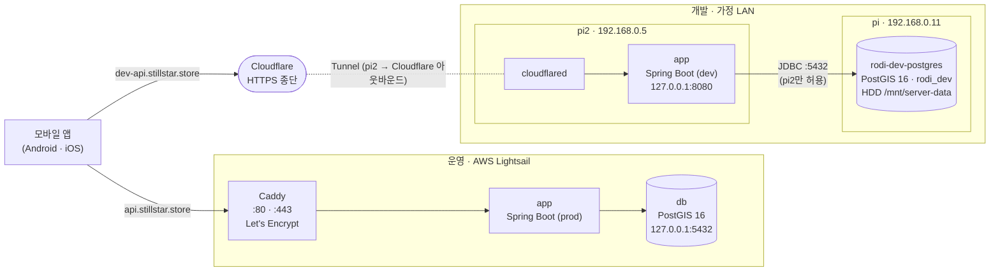
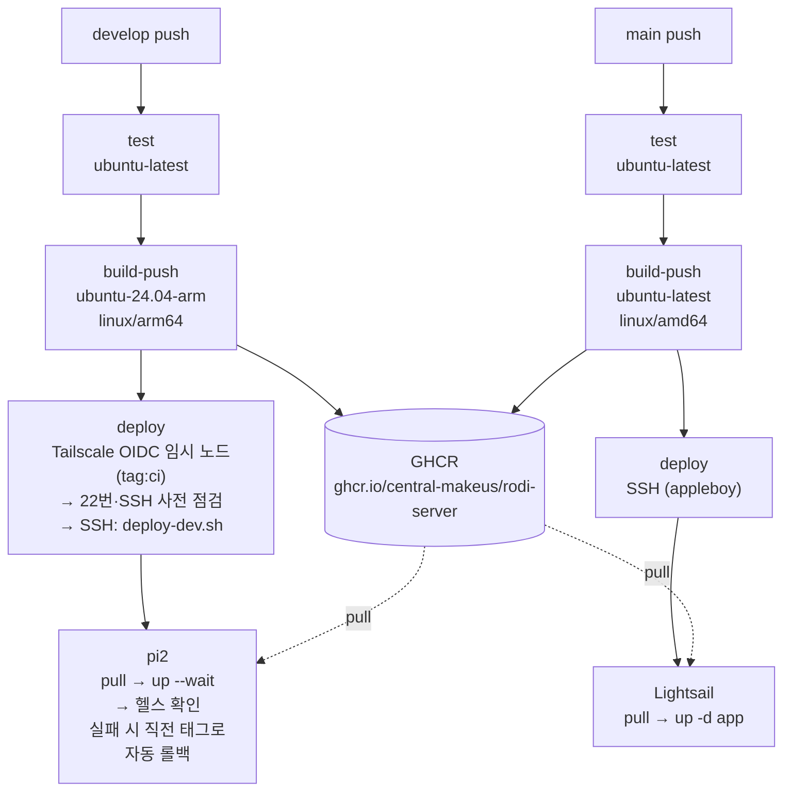

# 인프라 구성

Rodi 백엔드의 서버·네트워크·배포 구성을 한곳에 모은 문서다. 결정 배경은 ADR에 있다 — 운영 [ADR 0005](adr/0005-hosting-aws-lightsail.md), 개발 서버 [ADR 0017](adr/0017-dev-server-raspberry-pi-and-tailscale-deploy.md), 개발 서버 상세 설계 [스펙 023](specs/023-pi-dev-server-deploy.md).

> 시크릿 **값**은 이 문서에 적지 않는다(이름·위치만). 구성이 바뀌면 이 문서를 함께 고친다.

## 한눈에 보기

| 환경 | 브랜치 | 주소 | 서버 | 배포 워크플로 |
|------|--------|------|------|---------------|
| 운영 | `main` | `https://api.stillstar.store` | AWS Lightsail(서울, 1GB, amd64) — Caddy·app·DB 한 대 | [`cd.yml`](../.github/workflows/cd.yml) |
| 개발 | `develop` | `https://dev-api.stillstar.store` | Raspberry Pi 5 두 대(4GB, arm64) — `pi2` app, `pi` DB | [`cd-dev.yml`](../.github/workflows/cd-dev.yml) |
| 로컬 | — | `http://localhost:8080` | 개발자 PC — `bootRun` + [`compose.yaml`](../compose.yaml) DB | — |

Swagger는 각 주소의 `/swagger-ui.html`, 헬스체크는 `/actuator/health`.

## 런타임 구성

| 구성 요소 | 위치 | 설정 파일 |
|-----------|------|-----------|
| 운영 Caddy·app·db | Lightsail `/opt/rodi` | [`deploy/compose.prod.yaml`](../deploy/compose.prod.yaml), [`deploy/Caddyfile`](../deploy/Caddyfile), 서버 `.env`([예시](../deploy/.env.prod.example)) |
| 개발 app | pi2 `/opt/rodi-app` | [`deploy/compose.dev.yaml`](../deploy/compose.dev.yaml), [`deploy/deploy-dev.sh`](../deploy/deploy-dev.sh), 서버 `.env`([예시](../deploy/.env.dev.example)) |
| 개발 DB | pi `/opt/rodi-db` | 서버의 `compose.yaml`(레포 밖), 데이터 `/mnt/server-data/rodi/postgres` |
| 개발 Tunnel | pi2 `cloudflared` | Cloudflare 대시보드·pi2 설정(레포 밖) — app이 loopback에만 열려 있어 **pi2에서 `localhost:8080`으로 프록시**해야 한다 |

- 운영은 앱 프로필 `prod`, 개발은 `dev`([`application-dev.yml`](../src/main/resources/application-dev.yml)). 두 서버 모두 Flyway가 기동 시 마이그레이션을 검증·적용한다.
- 두 서버 모두 X-Forwarded-* 헤더를 신뢰한다(`forward-headers-strategy: framework`) — 앞단(Caddy / Cloudflare)이 HTTPS를 종단하기 때문.
- Discord 알림은 같은 웹훅을 쓰고 메시지 머리말(`[Rodi][prod]` / `[Rodi][dev]`)로 구분한다.

## 배포 흐름

| | 운영 (`cd.yml`) | 개발 (`cd-dev.yml`) |
|---|---|---|
| 트리거 | `main` push, 수동(main에서만) | `develop` push, 수동(`image_tag`로 재배포·롤백) |
| 이미지 태그 | `:<sha>`, `:main` (amd64) | `:dev-<sha>`, `:develop` (arm64) |
| 서버 접속 | 공인 IP로 SSH | Tailscale(OIDC) 경유 SSH, `known_hosts` 고정 |
| 헬스 확인 | 없음(기동 알림으로 확인) | `up --wait` + 컨테이너 내 `/actuator/health` |
| 실패 시 | 수동 조치 | 로그 출력 + 직전 성공 태그로 자동 롤백 → 잡 실패 |
| concurrency | `cd-deploy` | `cd-dev` |

PR(`main`·`develop` 대상)에는 [`ci.yml`](../.github/workflows/ci.yml)이 빌드·테스트를 돌린다. 개발 서버 롤백·복구 절차는 [스펙 023 "배포 실패와 복구"](specs/023-pi-dev-server-deploy.md#배포-실패와-복구).

## 접근 제어

| 경로 | 허용 | 막는 방법 |
|------|------|-----------|
| 인터넷 → 운영 | 80·443(Caddy), 22(SSH — `cd.yml` 배포·관리) | Lightsail 방화벽, app은 컨테이너 네트워크 내부, db는 `127.0.0.1:5432`(SSH 터널 전용) |
| 인터넷 → 개발 | `dev-api.stillstar.store`(Cloudflare Tunnel)만 | 공유기 포트포워딩 없음, app은 `127.0.0.1:8080` |
| pi2 → pi DB(5432) | pi2(`192.168.0.5`)만 | pi의 `DOCKER-USER` iptables 규칙(systemd `rodi-db-firewall`), 바인딩 `192.168.0.11` |
| GitHub Actions → pi2 | `tag:ci` → `tag:server`(pi2)의 TCP 22만 | Tailscale ACL, OIDC subject `repo:Central-MakeUs/Rodi-Server:ref:refs/heads/develop` |
| 내 기기 → pi·pi2 | 같은 LAN 또는 Tailscale | Tailscale ACL(`autogroup:member`) |
| 테스트용·내부 API | `local`·`dev` 프로필에서만 | `@DevOnly` (적용 대상은 스펙 023 참고) |

## GitHub Actions 설정값

| 이름 | 종류 | 쓰는 곳 | 내용 |
|------|------|---------|------|
| `SSH_HOST`, `SSH_KEY` | Secret | `cd.yml` | Lightsail 공인 IP, 배포 키 |
| `TS_OAUTH_CLIENT_ID`, `TS_AUDIENCE` | Secret | `cd-dev.yml` | Tailscale OIDC credential(비밀값은 아니지만 Secret으로 둠) |
| `PI2_HOST` | Secret | `cd-dev.yml` | pi2의 Tailscale IP |
| `PI2_SSH_KEY` | Secret | `cd-dev.yml` | 배포 개인키(`deploy` 사용자) |
| `PI2_SSH_HOST_KEY` | Secret | `cd-dev.yml` | pi2 공개 호스트 키 한 줄(`known_hosts`) |
| `PI2_SSH_USER` | **Variable** | `cd-dev.yml` | `deploy` — Secret이면 로그의 "deploy"가 전부 가려져서 Variable |
| `SONAR_TOKEN` | Secret | `ci.yml` | SonarCloud(미설정 시 분석 건너뜀) |
| `GITHUB_TOKEN` | 자동 | 전체 | GHCR push·pull |

앱 시크릿(DB·JWT·OAuth·Discord)은 GitHub이 아니라 **각 서버의 `.env`**에 있다. 운영과 개발은 JWT 시크릿이 다르다.
